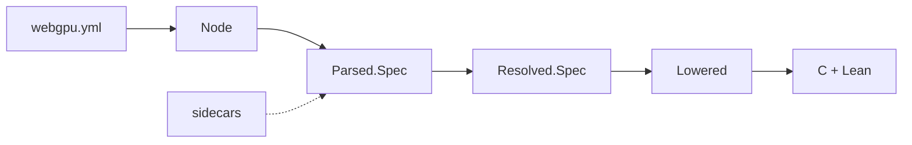

# webgpu-gen: Code Generator for `webgpu-raw-lean`

This Lean project is the code generator for `webgpu-raw-lean`. It uses the
[`webgpu.yml`][webgpu.yml] file from [`webgpu-headers`][webgpu-headers] as a
source of truth to generate C and Lean code for the raw bindings.

## Architecture

The code generator uses a straightforward pipeline illustrated below.

It consists of the following stages:

1. **Read YAML.** Parse [`webgpu.yml`][webgpu.yml] with [L4YAML][l4yaml] and
   convert the result into our own small `Node` tree. This is the only code
   that uses L4YAML (`Yaml.lean`).
2. **Parse the spec.** Decode the `Node` into a `Parsed.Spec`, a typed model
   of everything `webgpu.yml` says, with references still written as names.
   Scalars are interpreted by the YAML 1.2.2 core schema (`CoreSchema.lean`),
   and each part is read by a codec (`Parsed/Codec.lean`).
3. **Merge sidecar specs** *(planned)*. Read our own YAML files in the same 
   format (containing wgpu-native's extensions, and fix-ups for upstream 
   omissions) and merge them into the `Parsed.Spec`, so resolution checks them
   like everything else.
4. **Resolve references.** `check` reports every problem, each with its path
   in the YAML: unknown or duplicate names, and breaches of upstream's rules
   on ownership, defaults and namespaces. If there are none, `build` replaces
   each name with a typed ID of the entry it names, giving a `Resolved.Spec`
   (`Resolved/`).
5. **Lower.** Turn the resolved spec into the shapes the C and Lean printers
   need (`Lowered.lean`, `Lowered/`): names on both sides, how each value
   crosses between C and Lean, a callback's arguments included, struct
   defaults as C's initialisers give them, and what cannot be passed yet, so
   that it is not bound.
6. **Generate.** Print the C shims and the Lean bindings (`Emit/`): among them,
   each bound struct's encoders, and its table of where C fills in its
   pointers, with the proofs Lean checks as the bindings build
   (`Emit/Encoders.lean`); and each callback type, with the C trampoline that
   runs its Lean closure, and, for one a struct keeps, its info.

## Proofs

The code generation naturally relies on features of the WebGPU spec and its
interpretation that are not formalised externally. These do not really admit
proofs. However, key internal stages of the code generator are proved
correct in Lean. These provide strengthening arguments for the correctness of
the internal processing, and should not be regarded as absolute guarantees of
correctness, since that ultimately depends on the external spec
interpretation.

The main proofs we have (not a complete list) are:

- **Reading Scalars.** Some YAML scalars are proved to be read correctly by
  the YAML 1.2.2 core schema. For example:
  - a quoted or block scalar is always a string
  - every integer written in decimal, and every natural number in hex or
    octal, reads back as itself
  - only the core schema's integer forms are read as integers
- **Parsing the Spec.** For every spec `s` in our model,
  `decode (encode s) = .ok s`: everything the model can hold has a YAML form
  that reads back as itself. This *does not show* that `webgpu.yml` is read
  as upstream intends; that is tested against the real file.
- **Resolving References.** Resolution replaces names with IDs. `WellFormed r`
  says every ID points at a real entry, names are distinct where they must
  be, and upstream's rules hold. For a parsed spec `s` and a resolved spec
  `r`:
  - `resolve s = .ok r → WellFormed r`: what resolution returns is well formed
  - `resolve s = .ok r → unresolve r = s`: resolution loses nothing
  - `WellFormed r → resolve (unresolve r) = .ok r`: every well-formed spec
    comes from a parsed one

  Together: `WellFormed r ↔ ∃ s, resolve s = .ok r`. The resolved specs are
  exactly the well-formed ones.
- **Binding Structs.** `boundStructs` picks the structs to bind, in the order
  the Lean file declares them (`Lowered/BoundStructs.lean`):
  - each bound struct comes after every struct it refers to, so the file
    elaborates in order
  - every struct a bound struct refers to, however its type names it, is
    bound too, matched by both its C and its Lean name
  - a bound struct holds nothing the bindings cannot pass; nor, by the
    above, does any struct it refers to
- **Settling Defaults.** Defaults that refer to other structs are settled
  once all are lowered (`Lowered/Settle.lean`). In the settled spec:
  - no member of struct type keeps a `zero` default: each became its field
    values, from which the printer declares `T.zero`, or none, so the member
    must be given
  - each `nested` default, printed `{}`, names a struct whose every member has
    a default, at every depth

  With C names distinct, as the generator checks (below), the struct
  `complete` finds is the one the Lean file names. For `{}` to elaborate,
  each printed default must elaborate too: each `.zero` names a declared
  `T.zero` (below); that each entry and constant named exists is *not yet*
  proved.
- **Finding Zero Values.** A default of every byte zero is printed `.zero`,
  naming a `T.zero` to declare, both as a struct member's default and among
  the field values of a `T.zero`. `zeroValues` lists every such value the
  structs' defaults are or hold, however deep, and nothing else; so each
  `.zero` printed, in either place, names a listed one
  (`Emit/ZeroValues.lean`).
- **Lining Up Zero Values.** A zero value's `T.zero` pairs its struct's
  members with its field values by position. In the lowered spec, each zero
  value is of the struct its member holds, its field values name that
  struct's members, in order, and each fits its member's type, at every depth
  (`Lowered/ZeroFields.lean`).
- **Declaring Zero Values.** The printers find structs by their C names, so
  the generator checks that no two structs share one. Given that, in the
  lowered spec: each `.zero` printed, in either place, names a bound struct
  whose `T.zero` is declared, before the struct or `T.zero` that uses it;
  each `T.zero` declared is its struct's, lined up with its members; and
  each `{}` is of a bound struct, the one `complete` finds
  (`Emit/ZeroDecls.lean`).
- **Laying Out C Structs.** To pack a struct as C lays it out, the generator
  models C's layout rules for `webgpu.h`'s structs, on 64-bit and wasm32
  targets (`CLayout.lean`). For every struct, however deeply nested: each field,
  and each scalar within it, is aligned, lies within the struct, and ends
  before the next begins; and each scalar is at its field's offset, so
  checking fields' offsets checks scalars' too. The model is not trusted to
  match C: for every bound struct, the generated `layouts.c` asserts each
  field's offset and the struct's size and alignment, so the C compiler checks
  the model against `webgpu.h` on every target the build runs on. The test
  driver also checks each bound struct's fields are `webgpu.h`'s, named, in
  order, so none is left out where it could hide in padding.
- **Passing Objects to Callbacks.** Every object a callback passes to Lean
  is lowered as an `Option`, whatever the spec says, as C may pass NULL
  where it says it does not: so a callback is never given a Lean value of
  nothing (`nullable_of_callbackArgValue`, `Lowered/Lower.lean`).
- **Agreeing on Functions.** The C shims and the Lean declarations are both
  printed from one list of bound functions; each side prints a value only if
  it has a type for it. Wherever C has a shim, Lean has its `@[extern]`
  declaration and the function that calls it; and, for a callback, wherever
  C has its trampoline, Lean declares its closure's types, both as the
  function takes it and as the raw declaration does (`Emit/Agreement.lean`).
  That the two types of each value agree by Lean's ABI is *not* proved: it
  is checked by compiling them together (the repository's
  `scripts/check-abi.sh`); nor that a trampoline applies its closure to as
  many arguments as its type takes: both come from the callback's arguments,
  one each, and one trampoline, `requestAdapter`'s, is tested.

Lowering's other results are tested rather than proved, most against
`webgpu.h` itself: every C name, value and default it computes is checked
against the header upstream generates from the same spec.

## LLM Usage

Claude wrote most of this generator, in stages, with light review. The basic
architecture was decided by the human author in advance, and the proofs were
suggested by the human author.

Please feel free to re-write, re-format and re-architect any part of the
project "as a human". If you do so, note any files and/or sections you have
written as "human only", so that we can avoid mixing deeply human-authored
code, which is extremely valuable, with LLM-authored code, which isn't (sorry
Dario, but that's the reality).

[webgpu.yml]: https://github.com/webgpu-native/webgpu-headers/blob/main/webgpu.yml
[webgpu-headers]: https://github.com/webgpu-native/webgpu-headers
[l4yaml]: https://github.com/nasa-jpl/L4YAML
