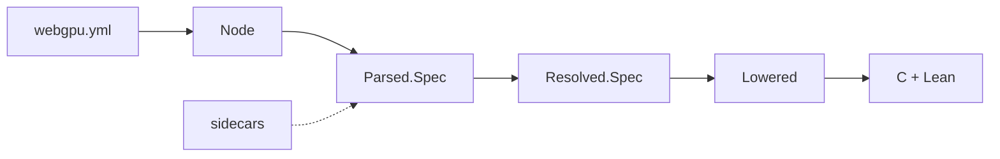

# webgpu-gen: Code Generator for `webgpu-raw-lean`

This Lean project is the code generator for `webgpu-raw-lean`. It uses the
[`webgpu.yml`][webgpu.yml] file from [`webgpu-headers`][webgpu-headers] as a
source of truth to generate C and Lean code for the raw bindings.

## Architecture

The code generator uses a straightforward pipeline illustrated below.

It consists of the following stages:

1. **Read YAML.** Parse [`webgpu.yml`][webgpu.yml] with [L4YAML][l4yaml] and
   convert the result into our own small `Node` tree. This is the only code
   that uses L4YAML (`Yaml.lean`).
2. **Parse the spec.** Decode the `Node` into a `Parsed.Spec`, a typed model
   of everything `webgpu.yml` says, with references still written as names.
   Scalars are interpreted by the YAML 1.2.2 core schema (`CoreSchema.lean`),
   and each part is read by a codec (`Parsed/Codec.lean`).
3. **Merge sidecar specs** *(planned)*. Read our own YAML files in the same 
   format (containing wgpu-native's extensions, and fix-ups for upstream 
   omissions) and merge them into the `Parsed.Spec`, so resolution checks them
   like everything else.
4. **Resolve references.** `check` reports every problem, each with its path
   in the YAML: unknown or duplicate names, and breaches of upstream's rules
   on ownership, defaults and namespaces. If there are none, `build` replaces
   each name with a typed ID of the entry it names, giving a `Resolved.Spec`
   (`Resolved/`).
5. **Lower** *(planned)*. Turn the resolved spec into the shapes the C and Lean
   printers need.
6. **Generate** *(planned)*. Print the C shim and the Lean bindings.

## Proofs

The code generation naturally relies on features of the WebGPU spec and its
interpretation that are not formalised externally. These do not really admit
proofs. However, key internal stages of the code generator are proved
correct in Lean. These provide strengthening arguments for the correctness of
the internal processing, and should not be regarded as absolute guarantees of
correctness, since that ultimately depends on the external spec
interpretation.

The main proofs we have (not a complete list) are:

- **Reading Scalars.** Some YAML scalars are proved to be read correctly by
  the YAML 1.2.2 core schema. For example:
  - a quoted or block scalar is always a string
  - every integer written in decimal, and every natural number in hex or
    octal, reads back as itself
  - only the core schema's integer forms are read as integers
- **Parsing the Spec.** For every spec `s` in our model,
  `decode (encode s) = .ok s`: everything the model can hold has a YAML form
  that reads back as itself. This *does not show* that `webgpu.yml` is read
  as upstream intends; that is tested against the real file.
- **Resolving References.** Resolution replaces names with IDs. `WellFormed r`
  says every ID points at a real entry, names are distinct where they must
  be, and upstream's rules hold. For a parsed spec `s` and a resolved spec
  `r`:
  - `resolve s = .ok r → WellFormed r`: what resolution returns is well formed
  - `resolve s = .ok r → unresolve r = s`: resolution loses nothing
  - `WellFormed r → resolve (unresolve r) = .ok r`: every well-formed spec
    comes from a parsed one

  Together: `WellFormed r ↔ ∃ s, resolve s = .ok r`. The resolved specs are
  exactly the well-formed ones.

## LLM Usage

Claude wrote most of this generator, in stages, with light review. The basic
architecture was decided by the human author in advance, and the proofs were
suggested by the human author.

Please feel free to re-write, re-format and re-architect any part of the
project "as a human". If you do so, note any files and/or sections you have
written as "human only", so that we can avoid mixing deeply human-authored
code, which is extremely valuable, with LLM-authored code, which isn't (sorry
Dario, but that's the reality).

[webgpu.yml]: https://github.com/webgpu-native/webgpu-headers/blob/main/webgpu.yml
[webgpu-headers]: https://github.com/webgpu-native/webgpu-headers
[l4yaml]: https://github.com/nasa-jpl/L4YAML
